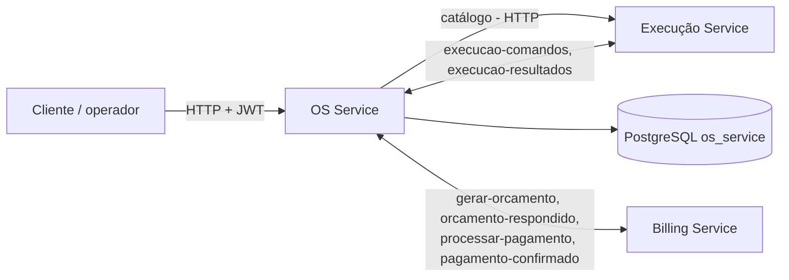

# OS Service

Microsserviço de Ordem de Serviço da Oficina FIAP (Tech Challenge Fase 4).

## Responsabilidade

Gerencia clientes, veículos e o ciclo de vida da ordem de serviço: abertura, itens (peças e serviços com o preço congelado), orçamento, aprovação, cancelamento, entrega, status e histórico. Também é o **orquestrador da Saga**, que coordena o Billing Service (orçamento e pagamento) e o Execução Service (execução do trabalho) por filas SQS.

## Documentação

- [Arquitetura do serviço](docs/arquitetura.md): lugar na solução, camadas, modelo de dados, status da OS, API e implantação.
- [Saga orquestrada](docs/saga-orquestrada.md): por que orquestrada, filas, fluxo feliz, o que o orquestrador faz com cada resposta, compensações e idempotência.
- [Diagrama geral da arquitetura da Fase 4](https://github.com/pisanohub/oficina-fiap-execucao-service/blob/main/docs/arquitetura-geral-fase4.md) e [ADRs do grupo](https://github.com/pisanohub/oficina-fiap-execucao-service/blob/main/docs/decisoes-fase4/README.md).
- Swagger UI: `/swagger-ui.html` (com a aplicação no ar).

## Arquitetura em resumo



**Estratégia da Saga: orquestrada, dentro do OS Service (ADR-P4).**
- O OS guarda o estado da Saga na própria OS (`StatusSaga`), envia os comandos e decide o próximo passo a cada evento.
- As compensações cancelam a OS e, quando já houve pagamento, pedem o estorno ao Billing.
- Se a execução já foi agendada, o OS primeiro pede o cancelamento ao Execução, que devolve as peças ao estoque.
- Cada mensagem recebida é registrada pelo `messageId`, e as repetidas são ignoradas.

Detalhes em [docs/saga-orquestrada.md](docs/saga-orquestrada.md).

## Tecnologias

- Java 21 e Spring Boot 4.0.5 (Web, Data JPA, Validation, Security, Actuator)
- PostgreSQL: database `os_service` no RDS compartilhado com o Billing, com usuário próprio (ADR-P2)
- Spring Cloud AWS (listener SQS) e AWS SDK v2 (envio de comandos ao SQS)
- Spring Cloud OpenFeign (catálogo do Execução Service)
- JWT (jjwt) para autenticação
- springdoc-openapi (Swagger UI)
- OpenTelemetry, Micrometer e Prometheus
- Lombok, Maven e Maven Wrapper
- JaCoCo (cobertura) e SonarCloud (quality gate no CI)

## Como rodar localmente

Pré-requisitos: Java 21, Docker e um PostgreSQL acessível (database `os_service`).

```bash
docker compose up -d
```

Isso sobe o LocalStack (porta 4566) e cria as seis filas da Saga (`init-aws.sh`). Depois:

```bash
export JWT_SECRET=um-segredo-local-com-pelo-menos-32-caracteres
./mvnw spring-boot:run
```

A API fica em `http://localhost:9090`. Para buscar o catálogo, o Execução Service precisa estar rodando em `OPEN_FEIGN_EXECUCAO_URL`.

Para rodar os testes:

```bash
./mvnw clean verify
```

No Windows, use `mvnw.cmd` no lugar de `./mvnw`.

### Variáveis de ambiente

| Variável | Padrão | Descrição |
| --- | --- | --- |
| `SPRING_DATASOURCE_URL` | `jdbc:postgresql://localhost:5432/os_service` | URL JDBC do PostgreSQL |
| `SPRING_DATASOURCE_USERNAME` | `postgres` | Usuário do banco |
| `SPRING_DATASOURCE_PASSWORD` | `postgres` | Senha do banco |
| `JWT_SECRET` | sem padrão (obrigatória) | Chave de assinatura dos tokens JWT |
| `AWS_REGION` | `us-east-1` | Região do SQS |
| `AWS_SQS_ENPOINT` | `http://localhost:4566` | Endpoint do SQS (LocalStack local; `https://sqs.us-east-1.amazonaws.com` no cluster) |
| `AWS_ACCESS_KEY` / `AWS_SECRET_KEY` | `test` | Credenciais estáticas. Vazias, o serviço usa as credenciais da instância (LabRole) |
| `OPEN_FEIGN_EXECUCAO_URL` | `http://localhost:8080` | Endereço do Execução Service para consultar o catálogo |

Health check: `GET /actuator/health`.

## Qualidade

| Medida (16/11/2026) | Valor |
| --- | --- |
| Testes automatizados | 285, todos passando |
| Cobertura de linhas (JaCoCo) | 88,6% |
| Análise no CI | SonarCloud com quality gate (`-Dsonar.qualitygate.wait=true`) |

O relatório de cobertura fica em `target/site/jacoco/index.html`.

## Deploy

O CI (`.github/workflows/ci.yml`) roda build, testes e Sonar. O CD (`.github/workflows/deploy.yml`) gera a imagem no GHCR e faz o deploy no K3s, no namespace `oficina-ms`:
- **ConfigMap:** banco, endpoint do SQS e nome do serviço para o OpenTelemetry.
- **Secret:** usuário e senha do banco e o `JWT_SECRET`.

O container escuta na porta 9090, e o Service `os-service` a expõe como 8080 dentro do cluster.

Video de demonstração da Fase 4 gravado em 17/11/2026.
