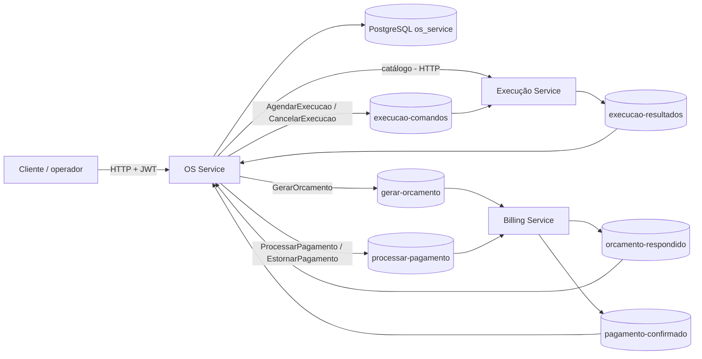
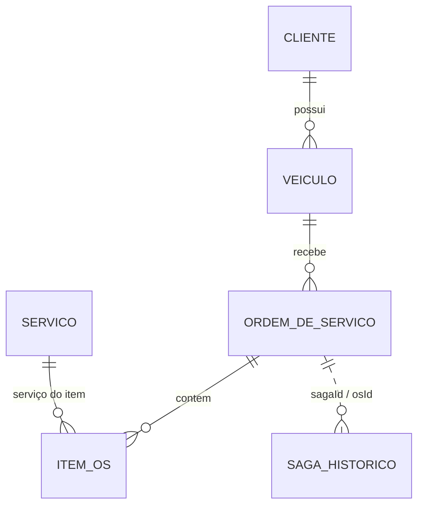
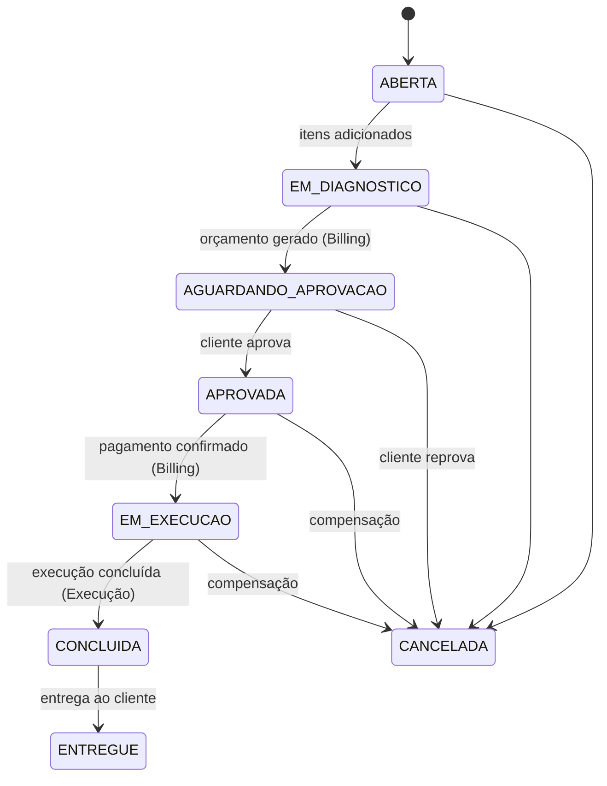

# Arquitetura do OS Service

O OS Service é o microsserviço de **Ordem de Serviço** da Oficina FIAP (Tech Challenge, Fase 4). Ele cuida de clientes, veículos e ordens de serviço, guarda o status e o histórico de cada OS e **orquestra a Saga** que coordena o Billing Service e o Execução Service.

Este documento descreve o que está implementado na `main` (revisão de 16/11/2026). A visão da solução inteira está no [diagrama geral da arquitetura](https://github.com/pisanohub/oficina-fiap-execucao-service/blob/main/docs/arquitetura-geral-fase4.md), e as decisões do grupo nos [ADRs da Fase 4](https://github.com/pisanohub/oficina-fiap-execucao-service/blob/main/docs/decisoes-fase4/README.md). O fluxo da Saga, mensagem a mensagem, está em [saga-orquestrada.md](saga-orquestrada.md).

## Lugar na solução

| Com quem | Como | Para quê |
| --- | --- | --- |
| Cliente e operador | HTTP (`/api/v1`), autenticado por JWT | Cadastro, abertura da OS, itens, orçamento, aprovação, cancelamento, entrega e consultas |
| Execução Service | HTTP (OpenFeign) `GET /api/v1/catalogo/{tipo}/{itemId}` | Buscar nome e preço da peça ou do serviço ao adicionar o item na OS (snapshot do preço, ADR-P4) |
| Billing Service | SQS | Gerar orçamento, cobrar e estornar |
| Execução Service | SQS | Agendar e cancelar a execução do trabalho |
| PostgreSQL (RDS) | JDBC / JPA | Database próprio `os_service` (ADR-P2) |

## Organização do código

O serviço segue as camadas usadas desde a Fase 1 (ADR-P6):

| Pacote | Conteúdo |
| --- | --- |
| `domain/entity` | `Cliente`, `Veiculo`, `OrdemDeServico`, `ItemOS`, `Servico`, `SagaHistorico`, `Usuario` e os enums de status (`StatusOS`, `StatusSaga`, `StatusBilling`, `StatusOrcamento`, `TipoItem`). |
| `domain/service` | Interfaces dos casos de uso (`OrdemDeServicoService`, `OrcamentoService`, `AgendaExecucaoService`, `ClienteService`, `VeiculoService`, `AuthService`). |
| `domain/validator` | Validação de CPF/CNPJ e placa. |
| `application/usecase` | Implementação dos casos de uso: ciclo da OS e transições de status, pedido de orçamento e de pagamento, agendamento da execução, clientes, veículos e autenticação. |
| `application/dto` | Objetos de entrada e saída da API. |
| `adapter/in/web` | Controllers REST e tratamento de erros. |
| `adapter/out/persistence` | Repositórios Spring Data JPA. |
| `adapter/out/gateway` | Cliente HTTP (OpenFeign) do catálogo do Execução. |
| `adapter/out/saga` | Saga: `in` tem o listener das filas e o orquestrador; `out` tem os publicadores dos comandos; `dto` tem os contratos das mensagens. |
| `config` | Segurança (JWT), AWS, Jackson, OpenFeign, OpenAPI e correlação de requisições. |

## Modelo de dados

| Tabela | O que guarda |
| --- | --- |
| `TB_ORDENS_SERVICO` | Status da OS (`StatusOS`) e da Saga (`StatusSaga`), `sagaId`, `orcamentoId`, `pagamentoId`, valor total, datas de abertura, início da execução, última mudança e fechamento, e `version` (bloqueio otimista). |
| `TB_ITENS_OS` | Itens da OS com o **preço congelado** no momento em que foram adicionados: `idOrigemItem` (o `itemId` do catálogo do Execução), tipo, nome, quantidade, preço unitário e subtotal. |
| `TB_SAGA_HISTORICO` | Cada mensagem enviada ou recebida na Saga: `messageId`, `operationId`, tipo, `sagaId`, `osId`, `causationId` e data. Serve para deduplicar mensagens e para consultar o histórico. |

O esquema é criado pelo Hibernate (`ddl-auto: update`).

## Status da OS

O status da OS descreve o negócio; o status da Saga (`StatusSaga`) registra a etapa da coordenação entre os serviços. As transições permitidas ficam em `OrdemDeServicoServiceImpl.validarTransicao`:

`ENTREGUE` e `CANCELADA` são terminais. Repetir o mesmo status é aceito, para que a reentrega de um evento não quebre o fluxo. A OS passa para `EM_EXECUCAO` quando o pagamento é confirmado e o comando `AgendarExecucao` é enviado.

## API HTTP

| Recurso | Rotas principais |
| --- | --- |
| Autenticação | `POST /auth/login`, `POST /auth/registro` (públicas) |
| Clientes | `POST`, `GET`, `PUT`, `DELETE` em `/api/v1/cliente`, e busca por `/cpfcnpj/{cpfCnpj}` |
| Veículos | `POST`, `GET`, `PUT`, `DELETE` em `/api/v1/veiculos` |
| Ordens de serviço | `POST /api/v1/ordens` (abrir), `POST /{id}/itens` e `DELETE /{id}/itens/{itemId}`, `POST /{id}/orcamento`, `POST /{id}/aprovar-orcamento` (cabeçalho `status-orcamento: APROVADO \| REJEITADO`), `POST /{id}/cancelar-os`, `POST /{id}/finalizar-entrega`, consultas por id, cliente, status, concluídas e orçamentos abertos, tempo médio de execução por período e `GET /{sagaId}/historico` |

**Segurança (Spring Security + JWT):**

- `/auth/**`, o Swagger e `/actuator/health` e `/actuator/prometheus` são públicos.
- O cliente pode consultar só as próprias ordens (`GET /api/v1/ordens/{id}`, `/{id}/status` e `/cliente/{clienteId}`), verificado por `OrdemAuthorization`.
- Todas as outras rotas exigem o papel `ADMIN`.

O Swagger UI fica em `/swagger-ui.html`.

## Implantação

| Item | Configuração |
| --- | --- |
| Porta | `9090` no container; o Service `os-service` (ClusterIP) expõe a porta `8080` dentro do cluster |
| Kubernetes | Namespace `oficina-ms`, um Deployment com requests de 256Mi/200m e limits de 512Mi/500m |
| Pipeline de CI | Build, testes e análise do SonarCloud com quality gate (`-Dsonar.qualitygate.wait=true`) |
| Pipeline de CD | Imagem no GHCR e deploy no K3s; ConfigMap com o banco, o endpoint do SQS e o nome do serviço para o OpenTelemetry; Secret com usuário e senha do banco e o `JWT_SECRET` |
| Credenciais AWS | Do perfil da instância (LabRole), quando as chaves estáticas estão vazias |

## Qualidade

Medido em 16/11/2026 com `./mvnw clean verify`: **285 testes, todos passando**, e **88,6% de cobertura de linhas** (JaCoCo). O CI barra o merge se o quality gate do SonarCloud reprovar.
