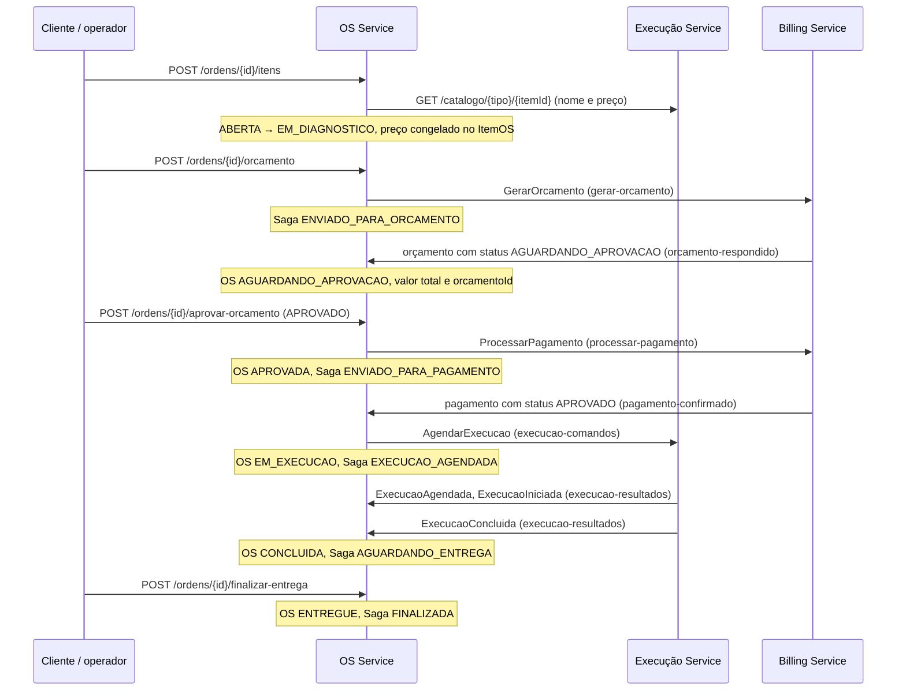
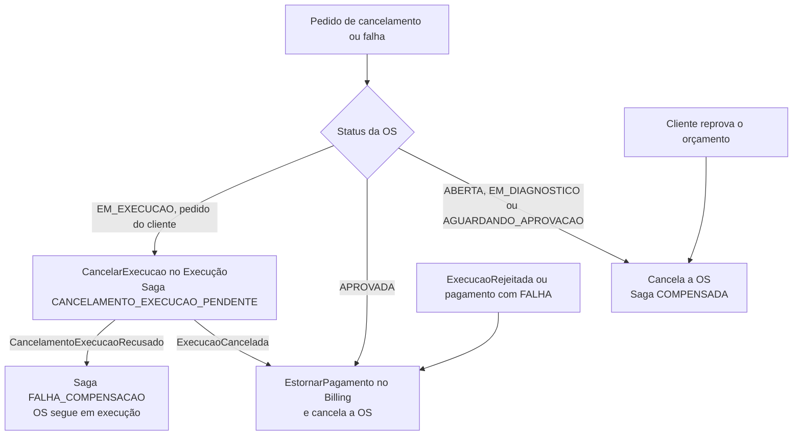

# Saga orquestrada pelo OS Service

O OS Service é o **orquestrador** da Saga da Fase 4 (ADR-P4). Ele guarda o estado da Saga no próprio banco, envia os comandos aos participantes (Billing e Execução) pelo SQS e decide o próximo passo a cada evento que recebe.

Este documento descreve o que está implementado na `main` (revisão de 16/11/2026). A arquitetura do serviço está em [arquitetura.md](arquitetura.md).

## Por que orquestrada

- **Um único lugar descreve o fluxo inteiro.** Fica mais fácil depurar, testar e demonstrar, e saber em que passo cada OS está (`StatusSaga` na própria OS).
- **Os participantes não se conhecem.** O Billing e o Execução só conversam com o OS, cada um pelas suas filas.
- **A coreografia foi descartada pelo grupo.** Ela é mais desacoplada, mas espalha a regra do fluxo pelos três serviços e fica mais difícil de acertar e de compensar dentro do prazo da fase.
- **Não há um quarto serviço só para o orquestrador.** Ele fica no OS, que já é dono do estado da OS (ADR-P1).

## Filas

| Fila | Direção | Quem publica no código | Quem consome no código |
| --- | --- | --- | --- |
| `gerar-orcamento` | OS → Billing | `SqsBillingService.enviarComandoGerarOrcamento` | Billing |
| `orcamento-respondido` | Billing → OS | Billing | `SagaSqsListener.escutarResultadosBillingOrcamento` |
| `processar-pagamento` | OS → Billing | `SqsBillingService.enviarComandoProcessarPagamento` | Billing |
| `pagamento-confirmado` | Billing → OS | Billing | `SagaSqsListener.escutarResultadosBillingPagamento` |
| `execucao-comandos` | OS → Execução | `SqsExecucaoService` | Execução |
| `execucao-resultados` | Execução → OS | Execução | `SagaSqsListener.escutarResultadosExecucao` |

As seis filas e as DLQs são criadas pelo Pedro no `oficina-fiap-infra-k8s`, com visibilidade de 30 s e 5 tentativas antes da DLQ. Os nomes ficam em `aws.sqs.url` no `application.yml`. Localmente, o `docker-compose.yml` sobe o LocalStack e o `init-aws.sh` cria as mesmas filas.

## Fluxo feliz

## O que o orquestrador faz com cada resposta

| Mensagem recebida | Ação do OS |
| --- | --- |
| Billing: orçamento com `status = AGUARDANDO_APROVACAO` | OS vai para `AGUARDANDO_APROVACAO`, grava o valor total e o `orcamentoId` |
| Billing: pagamento com `status = APROVADO` | Exige a OS em `APROVADA`; passa para `EM_EXECUCAO` com Saga `EXECUCAO_AGENDADA`, grava o `pagamentoId` e envia `AgendarExecucao` com os itens e serviços da OS |
| Billing: `status = FALHA` | Inicia a compensação com estorno (`EstornarPagamento`) |
| Execução: `ExecucaoAgendada` | Confirma a OS em `EM_EXECUCAO` |
| Execução: `ExecucaoIniciada` | Nenhuma (só um aviso no log) |
| Execução: `ExecucaoConcluida` | OS vai para `CONCLUIDA`, Saga `AGUARDANDO_ENTREGA` |
| Execução: `ExecucaoRejeitada` | Compensação: estorna o pagamento e cancela a OS |
| Execução: `ExecucaoCancelada` | Compensação: estorna o pagamento e cancela a OS |
| Execução: `CancelamentoExecucaoRecusado` | Saga `FALHA_COMPENSACAO`; a OS fica como está, para decisão do operador |

## Compensações

- **Cancelamento antes do pagamento:** a OS é cancelada direto; não há efeito a desfazer em outro serviço.
- **Depois do pagamento e antes da execução:** o OS envia `EstornarPagamento` pela fila `processar-pagamento` (campo `type`) e cancela a OS.
- **Durante a execução:** o OS pede `CancelarExecucao` ao Execução e espera a resposta. Se o trabalho ainda não começou, vem `ExecucaoCancelada` (o Execução devolve as peças ao estoque), e então o OS estorna o pagamento e cancela a OS. Se já começou, vem `CancelamentoExecucaoRecusado` e o caso fica com o operador.
- **Falta de peça:** `ExecucaoRejeitada` dispara o estorno e o cancelamento da OS. O Execução não reserva nada parcialmente.

## Idempotência e histórico

- Toda mensagem recebida é registrada em `TB_SAGA_HISTORICO` pelo `messageId`. Se a mesma mensagem chegar de novo (o SQS Standard entrega "pelo menos uma vez"), o listener a ignora.
- Os comandos enviados levam um `operationId` estável por operação (por exemplo, `gerar-orcamento-os-{id}` e `agendar-os-{id}-pagamento-{pagamentoId}`). É por ele que os participantes deduplicam.
- Repetir o mesmo status na OS é aceito, então reprocessar um evento não quebra a transição.
- Se o processamento de uma mensagem falha, o listener lança a exceção, a mensagem volta para a fila e, depois de 5 tentativas, vai para a DLQ.
- O histórico de uma Saga pode ser consultado em `GET /api/v1/ordens/{sagaId}/historico`.
